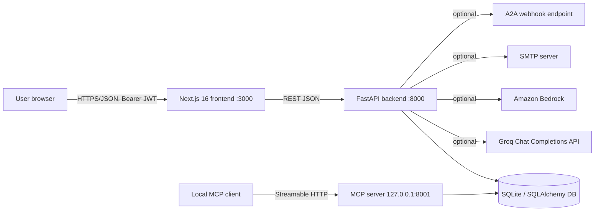
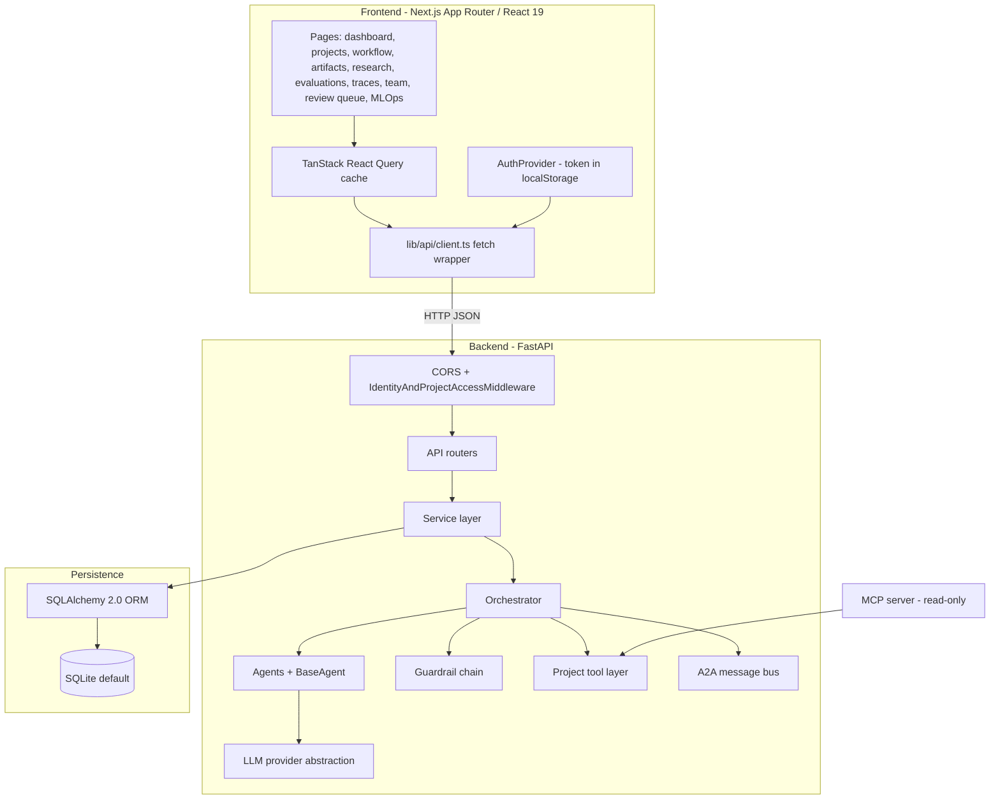
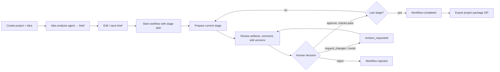
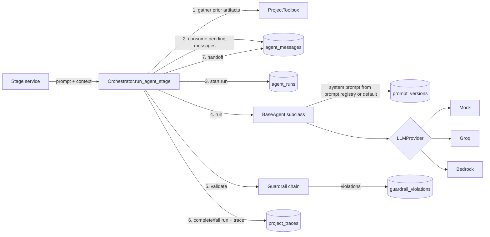
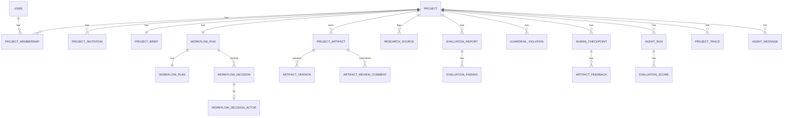
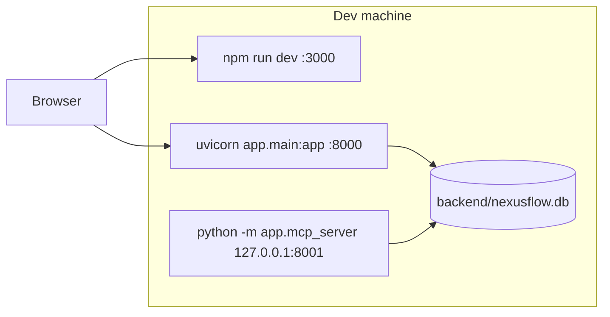
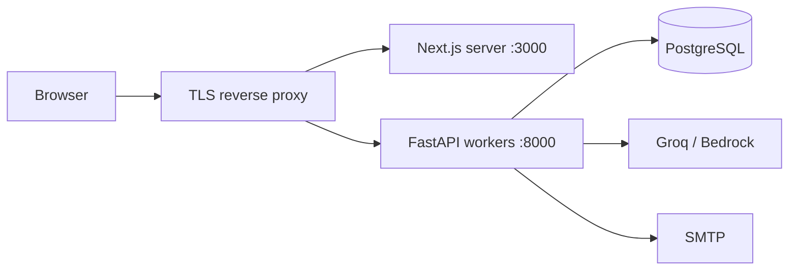

# NexusFlow — High-Level Design (HLD)

| Item | Value |
| --- | --- |
| System | NexusFlow — human-reviewed, multi-agent project planning workflow |
| Version | API 0.2.0 (backend `app/main.py`) |
| Status | Local-first prototype (not internet-hardened) |
| Companion doc | [LLD.md](LLD.md) — module, schema, and algorithm-level detail |

---

## 1. Purpose and scope

NexusFlow turns an early software idea into:

1. A structured **idea brief** (problem, users, goals, constraints, success criteria).
2. A sequence of **reviewable planning deliverables** (research plan, market analysis, technical feasibility, PRD, architecture outline, quality review, final package guide).
3. An **exportable ZIP package** with the brief, decisions, research log, review feedback, and full artifact version history.

Every stage is gated by an **explicit human decision**. AI agents draft content; humans approve, request changes, reject, or revisit.

### 1.1 In scope

- Project, brief, and workflow management with persisted state.
- Pluggable LLM provider (mock / Groq / Amazon Bedrock) behind six specialized agents.
- Guardrail chain on every agent output (content safety, schema, scope, length).
- Versioned Markdown artifacts, review comments, approval gating.
- Accounts, per-project roles (owner / editor / reviewer / viewer), invitations.
- Deterministic evaluations (consistency check, Devil's Advocate).
- Observability: traces, agent runs, token usage, cost estimates, prompt registry.
- In-process agent-to-agent (A2A) message bus, optional outbound webhook.
- Read-only local MCP server for external MCP clients.

### 1.2 Out of scope (current)

- Automated web research or source verification (sources are user-curated).
- Account recovery, email verification, login rate limiting, session revocation.
- Cross-network A2A protocol, connections to external MCP servers.
- Production deployment artefacts (no official Docker image, no HA setup).

---

## 2. Stakeholders and actors

| Actor | Description |
| --- | --- |
| Owner | Creates the project; full control including deletion, members, invitations |
| Editor | Edits project content, artifacts, research, starts/prepares workflow stages |
| Reviewer | Records workflow and HITL decisions, comments, resolves/overrides findings |
| Viewer | Read-only access |
| LLM provider | Groq (HTTP API) or Amazon Bedrock (via `strands-agents`); mock for dev/CI |
| MCP client | Local tool (IDE/assistant) reading project context via MCP on loopback |
| SMTP server | Optional, for invitation emails |
| A2A webhook | Optional external endpoint receiving agent handoff messages |

---

## 3. System context

---

## 4. Architecture overview

NexusFlow is a classic three-tier application with an embedded AI orchestration layer.

### 4.1 Architectural principles

1. **Human-in-the-loop** — no stage advances without an explicit, recorded decision.
2. **Durable state** — workflow, decisions, artifacts, and versions are persisted before continuation.
3. **Thin routes, fat services** — business logic lives in `services/`, routes do I/O mapping.
4. **Safe agent execution** — every agent output passes guardrails before persistence; HIGH/CRITICAL findings block.
5. **Honest fallbacks** — on the mock provider, agent stages use transparent deterministic templates rather than fake model output.
6. **Non-destructive regeneration** — preparing a stage again never overwrites reviewer edits.
7. **Single tool implementation** — agents (in-process) and MCP (external) share one read-only tool layer.

---

## 5. Major components

| # | Component | Location | Responsibility |
| --- | --- | --- | --- |
| 1 | Web UI | `frontend/src/app`, `components` | Project workspace, brief editor, workflow stepper/approvals, artifact viewer, research log, team, review queue, MLOps dashboards |
| 2 | API client | `frontend/src/lib/api`, `lib/hooks` | Typed REST calls, bearer injection, 401 handling, React Query hooks |
| 3 | Auth & access middleware | `backend/app/security.py` | JWT verification, project membership lookup, role-based path/method rules |
| 4 | REST API | `backend/app/api/*` | 14 routers: auth, projects, members, workflow, artifacts, research, review comments, evaluations, traces, guardrails, HITL, MLOps, dashboard |
| 5 | Workflow controller | `services/workflow_service.py` | Stage plan, state machine, approval gate checks, decision recording |
| 6 | Stage service | `services/stage_service.py` | Builds each stage's deliverables (agent or template) |
| 7 | Orchestrator | `services/orchestrator_service.py` | Single agent lifecycle: tools → A2A inbox → run record → agent → guardrails → persist → trace → handoff |
| 8 | Agents | `agents/*.py` | Idea analyst, market research, technical feasibility, PRD, architecture, quality evaluator |
| 9 | Provider abstraction | `agents/providers.py` | `LLMProvider` protocol + Mock / Groq / Bedrock implementations, JSON coercion |
| 10 | Guardrails | `guardrails/*` | Content filter, schema, scope, length validators; severity model |
| 11 | Artifact service | `services/artifact_service.py` | Artifact CRUD, versioning, artifact ZIP and full project package export |
| 12 | Evaluation service | `services/evaluation_service.py` | Deterministic consistency and Devil's Advocate reports |
| 13 | MLOps service | `services/mlops_service.py` | Agent run tracking, prompt registry, scores, cost estimation |
| 14 | A2A bus | `services/agent_message_service.py` | Persisted inter-agent messages; optional webhook delivery |
| 15 | HITL service | `services/hitl_service.py` | Standalone human checkpoints and artifact feedback |
| 16 | MCP server | `app/mcp_server.py` | Read-only MCP tools on loopback; single-member restriction |
| 17 | Persistence | `models/*`, `database.py`, `migrations/` | 23 tables, SQLAlchemy 2.0, Alembic initial migration |

---

## 6. Core business flow

### 6.1 Default stage plan (`full_product`)

| Order | Stage key | Required artifact(s) for approval | Generator |
| --- | --- | --- | --- |
| 1 | `idea_discovery` | Idea Brief | From the saved brief |
| 2 | `market_research` | Research Plan (+ optional Market Analysis) | Template from user sources; Market Research agent on live provider |
| 3 | `technical_feasibility` | Technical Feasibility | Technical Feasibility agent or template |
| 4 | `prd_architecture` | Product Requirements, Architecture Outline | PRD agent + Architecture agent (reads prior artifacts) or templates |
| 5 | `quality_review` | Quality Review (+ optional Agent Quality Review) | Deterministic evaluations; Quality Evaluator agent on live provider |
| 6 | `final_approval` | Final Package Guide | Template listing all artifacts |

Users may choose a subset/reordering (1–6 unique stage keys) when starting the workflow.

### 6.2 Approval gate (summary)

Approval of a stage is refused unless:

- All required artifacts exist and each has ≥ 10 words.
- No HIGH/CRITICAL content-filter hits in those artifacts.
- No unresolved review comments on them (all artifacts at `final_approval`).
- No unresolved HIGH/CRITICAL guardrail violations for the stage.
- After a `request_changes`/`revisit`, every required artifact has a newer version.

---

## 7. AI / agent architecture

**Agents and A2A wiring**

| Agent (`agent_name`) | Stage | Reads via tools | Hands off to |
| --- | --- | --- | --- |
| `idea_analyst` | brief generation (`POST /idea-analysis`) | — | — |
| `market_research` | market_research | — | `technical_feasibility` |
| `technical_feasibility` | technical_feasibility | — | `architecture_agent` |
| `prd_generator` | prd_architecture | — | — |
| `architecture_agent` | prd_architecture | Product Requirements, Technical Feasibility | — |
| `quality_evaluator` | quality_review | (artifact summaries inlined in prompt) | — |

**Failure policy:** guardrail block = hard failure (output not saved). Any other provider/agent error = fall back to the deterministic template so the stage can still be prepared.

---

## 8. Data architecture (logical)

Data groups: **identity** (users, memberships, invitations), **planning** (projects, briefs, workflow runs/plans/decisions), **content** (artifacts, versions, comments, research sources), **quality** (evaluations, guardrail violations, HITL checkpoints/feedback), **observability** (traces, agent runs, scores, prompt versions, agent messages). Full column-level schema is in the LLD.

---

## 9. Security architecture

| Concern | Design |
| --- | --- |
| Authentication | Email + password; PBKDF2-HMAC-SHA256 (310k iterations); HS256 JWT bearer, 12 h default expiry |
| Authorization | Central middleware: membership required for `/projects/{id}/**`; role rank viewer < reviewer < editor < owner, derived from path + HTTP method |
| Resource hiding | Non-members get **404** (not 403) for project resources |
| Invitations | Single-use random token, only SHA-256 hash stored, 7-day expiry, email must match |
| Secrets | Provider keys only in backend env; never in `NEXT_PUBLIC_*` |
| AI safety | Guardrails detect prompt injection, secret leakage, PII, toxicity, schema errors, off-scope or too-short output |
| MCP | Loopback only; refuses access when more than one account/member exists (no per-user identity yet) |
| Known gaps | Token in `localStorage` (XSS risk), no CSRF/HttpOnly cookies, no rate limiting, random signing key if unset |

---

## 10. Deployment view

### 10.1 Local (current, documented)

### 10.2 Target (from `docs/DEPLOYMENT.md`)

Requirements for target: stable `AUTH_SECRET_KEY`, `alembic upgrade head` instead of `create_all`, exact `CORS_ORIGINS`, `DEBUG=false`, MCP kept on loopback, HttpOnly session cookies.

---

## 11. Technology stack

| Layer | Technology |
| --- | --- |
| Frontend | Next.js 16 (App Router), React 19, TypeScript 5, TanStack React Query 5, react-hook-form + zod, Tailwind CSS 3, react-markdown + remark-gfm, recharts, lucide-react |
| Backend | Python 3.10+, FastAPI 0.143, Starlette, Uvicorn, Pydantic 2 / pydantic-settings, sse-starlette |
| Data | SQLAlchemy 2.0, Alembic 1.20, SQLite (dev) |
| Auth | PyJWT (HS256), hashlib PBKDF2 |
| AI | httpx (Groq), strands-agents + boto3 (Bedrock), MCP SDK (`mcp`) |
| Testing | pytest + FastAPI TestClient, Playwright e2e |
| CI | GitHub Actions: backend pytest, frontend lint/typecheck/build, Playwright e2e |

---

## 12. Non-functional requirements

| Attribute | Current approach | Gap / note |
| --- | --- | --- |
| Reliability | Persist-before-continue; deterministic fallbacks on provider failure | No provider retries/backoff |
| Auditability | Decisions with actor, traces, agent runs, artifact versions | Traces are app history, not distributed tracing |
| Performance | Synchronous agent calls inside request (timeout 60 s) | Long requests; no background job queue |
| Scalability | Stateless API if `AUTH_SECRET_KEY` is stable | SQLite single-writer; SSE endpoint only heartbeats |
| Cost visibility | Token counts + per-model price table (Groq, Bedrock) | Bedrock returns no usage, so its cost shows 0 |
| Testability | Mock provider; CI needs no paid keys | Role-denial matrix lightly tested |
| Portability | `DATABASE_URL` configurable | Only SQLite is validated |

---

## 13. Key design decisions

| Decision | Rationale | Trade-off |
| --- | --- | --- |
| Central auth middleware instead of per-route dependencies | One place for membership and role rules | Rules are substring-based on paths; fragile for new routes |
| Provider protocol + factory | Swap mock/Groq/Bedrock via `LLM_PROVIDER` | Bedrock path lacks token accounting |
| Guardrails before persistence | Unsafe output never becomes an artifact | Blocking can stall a stage until an override |
| Non-destructive `prepare` | Protects reviewer edits | Regeneration needs a manual new version |
| Mock disables agent stages entirely | Never present fake reasoning as real | Mock runs exercise templates, not agent paths |
| Shared tool layer for agents and MCP | Single source of truth for read access | MCP lacks user identity, so it is restricted |
| Persisted A2A bus | Auditable, inspectable handoffs | In-process only; webhook is fire-and-forget |

---

## 14. Risks and future work

- Move tokens to HttpOnly cookies + CSRF; add password reset, verification, rate limiting.
- Background job queue for agent runs, plus provider retries with backoff.
- Real event push for `/dashboard/events` (currently heartbeat only).
- Enable SQLite FK enforcement or add ORM cascades so project deletion cleans up child rows.
- Model-aware Bedrock usage capture; source discovery with citations.
- Authenticated MCP transport so multi-member projects can be exposed.
