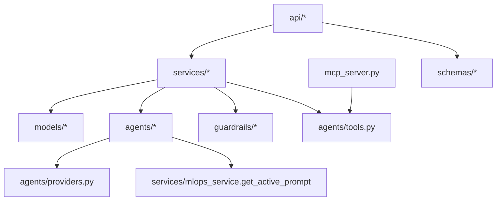
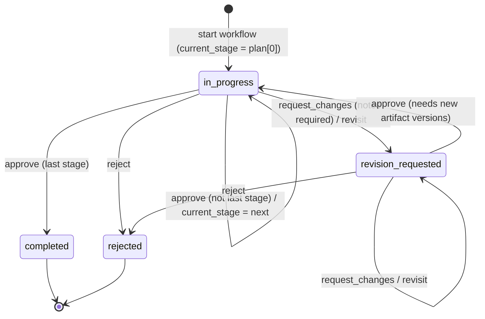
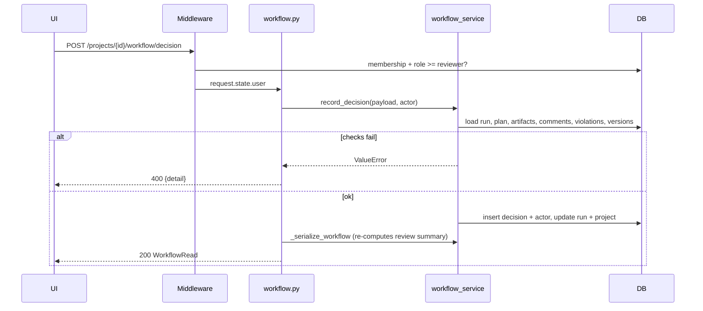
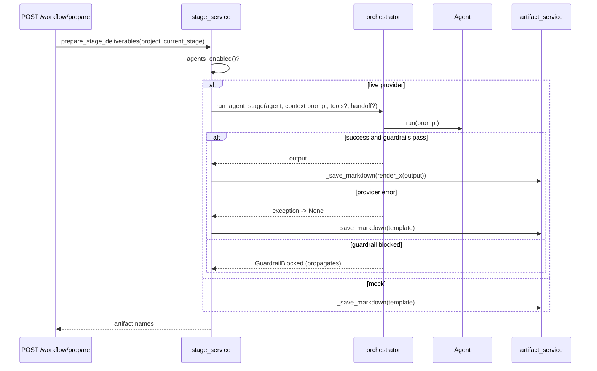
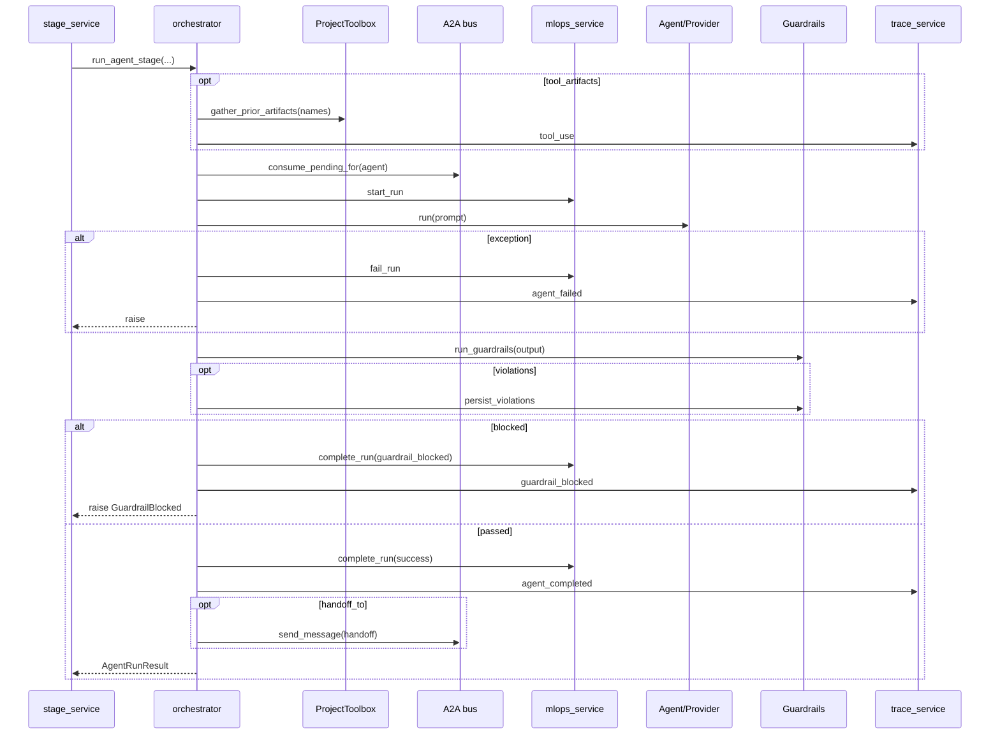
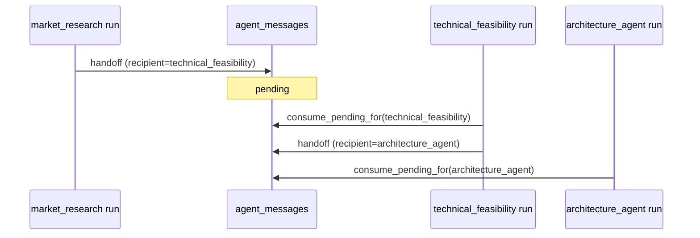

# NexusFlow — Low-Level Design (LLD)

Companion to [HLD.md](HLD.md). All backend paths are relative to `backend/app/` unless stated otherwise. This document reflects the code as it is, including known quirks (marked **Note**).

## Contents

1. [Code layout](#1-code-layout)
2. [Configuration](#2-configuration)
3. [Persistence layer](#3-persistence-layer)
4. [Authentication and authorization](#4-authentication-and-authorization)
5. [API specification](#5-api-specification)
6. [Workflow engine](#6-workflow-engine)
7. [Stage deliverable generation](#7-stage-deliverable-generation)
8. [Agent framework](#8-agent-framework)
9. [Orchestrator](#9-orchestrator)
10. [Guardrails](#10-guardrails)
11. [Artifacts, versioning, export](#11-artifacts-versioning-export)
12. [Evaluations](#12-evaluations)
13. [MLOps: runs, prompts, cost](#13-mlops-runs-prompts-cost)
14. [A2A message bus](#14-a2a-message-bus)
15. [HITL checkpoints](#15-hitl-checkpoints)
16. [MCP server](#16-mcp-server)
17. [Other services](#17-other-services)
18. [Frontend design](#18-frontend-design)
19. [Error handling](#19-error-handling)
20. [Build, test, CI](#20-build-test-ci)
21. [Known issues and gotchas](#21-known-issues-and-gotchas)

---

## 1. Code layout

```text
backend/
  app/
    main.py                 FastAPI app, middleware, router registration, /health
    config.py               Settings (pydantic-settings), get_settings() lru_cache
    database.py             engine, SessionLocal, Base, get_db(), init_db()
    security.py             IdentityAndProjectAccessMiddleware, ROLE_RANK
    mcp_server.py           Local read-only MCP server (127.0.0.1:8001)
    api/                    14 routers (auth, projects, members, workflow, artifacts, research,
                            review_comments, evaluations, traces, guardrails, hitl, mlops, dashboard) + deps.py
    agents/                 providers.py, base.py, tools.py, 6 agent modules
    guardrails/             base.py, registry.py, content_filter.py, schema_validator.py,
                            scope_validator.py, length_validator.py
    models/                 23 SQLAlchemy models in 14 modules
    schemas/                Pydantic v2 request/response models
    services/               business logic (16 modules)
  migrations/               Alembic env + 1 initial migration
  tests/                    pytest suites (phase1–7, guardrails/HITL/MLOps)
frontend/
  src/app/                  App Router pages, layout, providers, app-shell
  src/components/           ui/, workflow/, artifacts/, hitl/, guardrails/, mlops/
  src/lib/api/              fetch client + domain API modules
  src/lib/hooks/            React Query hooks
  src/lib/types/api.ts      TypeScript DTOs
  e2e/                      Playwright spec
```

### 1.1 Layering rules



---

## 2. Configuration

`config.py` → `Settings(BaseSettings)`, `env_file=".env"`, case-insensitive, `extra="ignore"`, cached via `@lru_cache get_settings()`.

| Setting | Default | Notes |
| --- | --- | --- |
| `app_name` | `NexusFlow` | |
| `environment` | `development` | |
| `debug` | `True` | Also drives SQLAlchemy `echo` |
| `backend_host` / `backend_port` | `0.0.0.0` / `8000` | |
| `database_url` | `sqlite:///./nexusflow.db` | |
| `cors_origins` | `["http://localhost:3000"]` | JSON list |
| `llm_provider` | `bedrock` | `mock` \| `groq` \| `bedrock`; `.env.example` uses `mock` |
| `llm_model`, `bedrock_model_id` | `anthropic.claude-3-5-sonnet-20240620-v1:0` | |
| `aws_region` | `us-west-2` | |
| `aws_access_key_id`, `aws_secret_access_key`, `llm_api_key` | `None` | |
| `groq_api_key` | `None` | |
| `groq_model` | `openai/gpt-oss-120b` | |
| `llm_timeout_seconds` | `60` | Groq httpx timeout |
| `auth_secret_key` | `secrets.token_urlsafe(48)` per process | min length 32 |
| `auth_token_expire_minutes` | `720` | |
| `frontend_base_url` | `http://localhost:3000` | Invite links |
| `email_enabled` | `False` | |
| `email_from` | `NexusFlow <no-reply@nexusflow.local>` | |
| `smtp_host/port/user/password/use_tls/timeout_seconds` | `None/587/None/None/True/15` | |
| `a2a_external_delivery_enabled` | `False` | |
| `a2a_webhook_url/token/timeout_seconds` | `None/None/10` | |

---

## 3. Persistence layer

### 3.1 Engine and session (`database.py`)

- `engine = create_engine(database_url, echo=debug, connect_args={"check_same_thread": False} if sqlite)`.
- `SessionLocal = sessionmaker(autocommit=False, autoflush=False)`.
- `get_db()` — generator dependency: yield session, close in `finally`.
- `init_db()` — `Base.metadata.create_all()` **only for SQLite**; other engines must run `alembic upgrade head`. Called at import time of `main.py` and again in `lifespan`.

### 3.2 Conventions

- PK: `id String(36)` with `uuid4()` default (except `workflow_decision_actors`).
- Timestamps: naive `DateTime`, Python default `datetime.now(timezone.utc)`; `updated_at` has `onupdate`.
- No `relationship()` objects. All links are plain `ForeignKey` columns; joins are explicit `select()` queries.
- No DB enums. Enumerations are strings validated in schemas/services.
- `ondelete="CASCADE"` exists only on `project_memberships`, `project_invitations`, `workflow_decision_actors`.

### 3.3 Tables

#### Identity

**`users`**

| Column | Type | Constraints |
| --- | --- | --- |
| id | String(36) | PK |
| email | String(320) | UNIQUE, NOT NULL, indexed (lower-cased) |
| display_name | String(120) | NOT NULL |
| password_hash | String(255) | NOT NULL (`pbkdf2_sha256$iter$salt$hash`) |
| created_at | DateTime | NOT NULL |

**`project_memberships`** — UNIQUE(`project_id`, `user_id`) `uq_project_membership_user`

| Column | Type | Constraints |
| --- | --- | --- |
| id | String(36) | PK |
| project_id | FK projects.id | CASCADE, NOT NULL, idx |
| user_id | FK users.id | CASCADE, NOT NULL, idx |
| role | String(24) | NOT NULL, default `viewer` |
| created_at | DateTime | NOT NULL |

**`project_invitations`**

| Column | Type | Constraints |
| --- | --- | --- |
| id | String(36) | PK |
| project_id | FK projects.id | CASCADE, NOT NULL, idx |
| email | String(320) | NOT NULL, idx |
| role | String(24) | NOT NULL |
| token_hash | String(64) | UNIQUE, NOT NULL (SHA-256 hex) |
| invited_by_user_id | FK users.id | NOT NULL |
| expires_at | DateTime | NOT NULL (now + 7 days) |
| accepted_at | DateTime | NULL |
| created_at | DateTime | NOT NULL |

**`workflow_decision_actors`** (1:1 extension of a decision)

| Column | Type | Constraints |
| --- | --- | --- |
| decision_id | FK workflow_decisions.id | PK, CASCADE |
| user_id | FK users.id | NOT NULL, idx |
| display_name | String(120) | NOT NULL |
| email | String(320) | NOT NULL |
| created_at | DateTime | NOT NULL |

#### Planning

**`projects`**: `id` PK; `name` String(255) NN; `description` Text NULL; `idea` Text NN; `status` String(50) NN default `draft`; `created_at`; `updated_at`.

**`project_briefs`**: `id` PK; `project_id` FK UNIQUE NN idx; `problem_statement` Text NN; `target_users`, `goals`, `constraints`, `success_criteria`, `clarifying_questions` JSON NN default `[]`; timestamps.

**`workflow_runs`**: `id` PK; `project_id` FK UNIQUE NN idx (one run per project); `current_stage` String(50) default `idea_discovery`; `status` String(50) default `in_progress`; `last_decision` String(50) NULL; timestamps.

**`workflow_plans`**: `id` PK; `workflow_run_id` FK UNIQUE NN idx; `template_key` String(80) default `full_product`; `stage_keys` Text NN (JSON-encoded list); `created_at`.

**`workflow_decisions`**: `id` PK; `workflow_run_id` FK idx; `project_id` FK idx; `stage` String(50); `action` String(50); `notes` Text NULL; `created_at`.

#### Content

**`project_artifacts`**: `id` PK; `project_id` FK idx; `name` String(255); `type` String(50) default `markdown`; `content` Text default `""`; `current_version` Integer default 1; timestamps. **Note:** no unique (project_id, name), though code treats name as a key.

**`artifact_versions`**: `id` PK; `artifact_id` FK idx; `project_id` FK idx; `version` Integer; `content` Text; `summary` Text NULL; `created_at`.

**`artifact_review_comments`**: `id` PK; `project_id` FK idx; `artifact_id` FK idx; `version_number` Integer; `reviewer_name` String(100); `section_key` String(255) default `Document`; `comment` Text; `suggested_edit` Text NULL; `resolved` Boolean default False; `created_at`; `resolved_at` NULL.

**`research_sources`**: `id` PK; `project_id` FK idx; `title` String(255); `url` String(2000); `finding` Text; `notes` Text NULL; `added_by` String(100) default `Reviewer`; `reviewed` Boolean default False; timestamps.

#### Quality

**`evaluation_reports`**: `id`; `project_id` FK idx; `report_type` String(80) (`consistency_check` | `devils_advocate`); `status` default `completed`; `summary` Text; timestamps.

**`evaluation_findings`**: `id`; `report_id` FK idx; `category` String(80); `severity` String(20) (`info`|`warning`|`critical`); `title` String(255); `description` Text; `evidence` Text NULL; `recommendation` Text NULL; `created_at`.

**`guardrail_violations`**: `id`; `project_id` FK idx; `stage` String(80); `agent_name` String(80); `rule_name` String(80); `severity` String(20) (`low`|`medium`|`high`|`critical`); `message` Text; `detail` Text NULL (JSON); `auto_blocked` Boolean default True; `overridden_by` String(255) NULL; `override_note` Text NULL; `resolved_at` NULL; `created_at`.

**`human_checkpoints`**: `id`; `project_id` FK idx; `stage` String(80); `status` default `pending` (`pending`|`approved`|`approved_with_edits`|`rejected`); `checkpoint_type` default `post_generation` (`pre_stage`|`post_generation`|`violation_override`); `agent_output` Text JSON; `human_feedback` Text JSON; `reviewer_notes`; `reviewed_by`; `expires_at`; `reviewed_at`; timestamps.

**`artifact_feedback`**: `id`; `checkpoint_id` FK idx; `artifact_id` FK idx; `project_id` FK idx; `section_key` String(255); `comment` Text; `suggested_edit` NULL; `resolved` Boolean default False; `created_at`.

#### Observability

**`agent_runs`**: `id`; `project_id` FK idx; `stage` String(80) idx; `agent_name` String(80) idx; `prompt_version` Integer default 1; `model_id` String(120); `status` String(30) default `running` idx (`running`|`success`|`failed`|`guardrail_blocked`); `input_tokens`, `output_tokens`, `latency_ms` Integer NULL; `raw_input`, `raw_output`, `error_message` Text NULL; `evaluation_score` Float NULL; `started_at`; `completed_at` NULL.

**`prompt_versions`**: `id`; `agent_name` String(80) idx; `version` Integer; `content` Text; `change_note` NULL; `is_active` Boolean default False; `created_at`; `deprecated_at` NULL. **Note:** "one active per agent" is enforced in service code only.

**`evaluation_scores`**: `id`; `agent_run_id` FK idx; `metric_name` String(80); `score` Float (0–1); `explanation` NULL; `created_at`.

**`project_traces`**: `id`; `project_id` FK idx; `event` String(80); `stage` String(80); `message` Text; `details` Text NULL (JSON); `created_at`.

**`agent_messages`**: `id`; `project_id` FK idx; `sender` String(80) idx; `recipient` String(80) idx; `message_type` String(30) default `context` (`request`|`context`|`response`|`handoff`); `content` Text; `status` String(20) default `pending` idx (`pending`|`consumed`); `in_reply_to` String(36) NULL (logical self-ref, no FK); `created_at`; `consumed_at` NULL.

### 3.4 Migrations

- `alembic.ini`: `script_location=migrations`, file template `YYYYMMDD_HHMM_rev_slug`.
- `migrations/env.py`: URL from `get_settings().database_url`; `target_metadata = Base.metadata`; `render_as_batch=True` for SQLite; `compare_type=True`; online mode uses `NullPool`.
- One revision: `20261025_2051_af0f70662b9a_initial_schema.py` (creates all 23 tables).

---

## 4. Authentication and authorization

### 4.1 Password hashing (`services/auth_service.py`)

```text
hash_password(pw):
  salt = token_bytes(16)
  dk   = pbkdf2_hmac("sha256", pw, salt, 310_000)
  return "pbkdf2_sha256$310000$<salt_hex>$<dk_hex>"

verify_password(pw, encoded):
  split on "$" -> (alg, iter, salt_hex, digest_hex); alg must be pbkdf2_sha256
  recompute with stored iter; hmac.compare_digest; any parse error -> False
```

### 4.2 Access token

- PyJWT, `HS256`, key `auth_secret_key`.
- Claims: `sub=user.id`, `iat=now`, `exp=now + auth_token_expire_minutes*60`.
- `decode_access_token` → `sub` (str) or `None` on any `PyJWTError`.

### 4.3 Invitations

```mermaid
sequenceDiagram
    participant O as Owner
    participant API
    participant DB
    participant I as Invitee
    O->>API: POST /projects/{id}/invitations {email, role}
    API->>API: token = token_urlsafe(36)
    API->>DB: insert invitation(token_hash=sha256(token), expires_at=now+7d)
    API-->>O: InvitationRead + invite_token (+ email_sent if SMTP)
    O-->>I: share /invite?token=...
    I->>API: POST /auth/invitations/accept {token} (signed in)
    API->>DB: find by sha256(token)
    alt not found / already accepted
        API-->>I: 404
    else expired
        API-->>I: 410
    else email mismatch
        API-->>I: 403
    else ok
        API->>DB: insert membership(role) if none; set accepted_at
        API-->>I: {project_id, role, status}
    end
```

### 4.4 Middleware (`security.py` → `IdentityAndProjectAccessMiddleware`)

Middleware order: `CORSMiddleware` added first, identity middleware added second (so identity is outermost).

```text
dispatch(request):
  path = rstrip("/")
  if OPTIONS or path in PUBLIC_PATHS or path startswith "/_next/": pass through
     PUBLIC_PATHS = {/health, /auth/register, /auth/login, /docs, /redoc, /openapi.json}
  token = Bearer header -> decode_access_token -> user_id; else 401 "Sign in to access NexusFlow."
  user = db.get(User); else 401 "Account no longer exists."
  if path matches /projects/{id}/... (id not "" or "new"):
      project missing      -> 404
      membership missing   -> 404 (hides existence)
      _role_denial(...)    -> 403
  if path startswith /mlops/runs/{run_id}: run missing or caller not member -> 404
  if path startswith /dashboard/events/{project_id}: caller not member -> 404
  request.state.user = user; call_next
```

**Role rank:** `viewer=1 < reviewer=2 < editor=3 < owner=4`.

**`_role_denial(path, method, role)` — first match wins:**

| # | Condition | Required role |
| --- | --- | --- |
| 1 | `"/invitations"` in path, or `"/members"` in path and method ≠ GET | owner |
| 2 | `DELETE` and `path.count("/") == 2` (i.e. `DELETE /projects/{id}`) | owner |
| 3 | POST/PUT/PATCH/DELETE and path contains `/decision`, `/review`, `/feedback`, `/comments`, or `/override` | reviewer |
| 4 | Any other POST/PUT/PATCH/DELETE | editor |
| 5 | Otherwise (GET) | viewer |

Additional in-handler checks: MLOps prompt create/activate require owner of at least one project; members routes block demoting/removing the last owner, self-transfer, and self-invite.

---

## 5. API specification

All non-public routes need `Authorization: Bearer <jwt>`. "Role" = minimum role enforced by middleware. Validation errors return 422.

### 5.1 Auth (`/auth`)

| Method | Path | Role | Request | Response | Codes |
| --- | --- | --- | --- | --- | --- |
| POST | /auth/register | public | `RegisterRequest{email, display_name 1–120, password 10–128}` | `TokenRead` | 201, 409 |
| POST | /auth/login | public | `LoginRequest{email, password}` | `TokenRead` | 200, 401 |
| GET | /auth/me | auth | — | `UserRead` | 200, 401 |
| POST | /auth/invitations/accept | auth | `InviteAccept{token 32–128}` | `{project_id, role, status}` | 200, 403, 404, 410 |

`TokenRead = {access_token, token_type="bearer", expires_in, user: UserRead}`. Emails are stripped, lower-cased, regex-validated, ≤ 320 chars.

### 5.2 Projects and brief (`/projects`)

| Method | Path | Role | Request | Response | Codes |
| --- | --- | --- | --- | --- | --- |
| GET | /projects | auth (own memberships) | — | `ProjectRead[]` | 200 |
| POST | /projects | auth (creator → owner) | `ProjectCreate{name 1–255, description?, idea 10–10000}` | `ProjectRead` | 201 |
| GET | /projects/{id} | viewer | — | `ProjectRead` | 200, 404 |
| PATCH | /projects/{id} | editor | `ProjectUpdate{name?, description?, idea?, status? ∈ draft/active/archived/review}` | `ProjectRead` | 200, 404 |
| DELETE | /projects/{id} | owner | — | `{status:"deleted", id}` | 200, 404 |
| POST | /projects/{id}/idea-analysis | editor | — | `ProjectBriefRead` | 200, 404, 422 (guardrail), 502 (provider) |
| GET | /projects/{id}/idea-analysis | viewer | — | `ProjectBriefRead` | 200, 404 |
| PUT | /projects/{id}/idea-analysis | editor | `ProjectBriefBase` | `ProjectBriefRead` | 200, 404 |

### 5.3 Team (`/projects/{id}`)

| Method | Path | Role | Request | Response | Codes |
| --- | --- | --- | --- | --- | --- |
| GET | /members | viewer | — | `MemberRead[]` | 200 |
| POST | /invitations | owner | `InviteCreate{email, role ∈ editor/reviewer/viewer}` | `InvitationRead` | 201, 400 |
| GET | /invitations | owner | — | `InvitationRead[]` (pending, unexpired) | 200 |
| DELETE | /invitations/{iid} | owner | — | — | 204, 404 |
| PATCH | /members/{uid} | owner | `{role ∈ editor/reviewer/viewer}` | `MemberRead` | 200, 400, 404 |
| DELETE | /members/{uid} | owner | — | — | 204, 400, 404 |
| POST | /members/{uid}/transfer-ownership | owner | — | `MemberRead` | 200, 400, 404 |

### 5.4 Workflow

| Method | Path | Role | Request | Response | Codes |
| --- | --- | --- | --- | --- | --- |
| POST | /projects/{id}/workflow | editor | `WorkflowStart{template_key="full_product", stage_plan[1..6]}` (optional) | `WorkflowRead` | 200, 404, 422 |
| GET | /projects/{id}/workflow | viewer | — | `WorkflowRead` | 200, 404 |
| POST | /projects/{id}/workflow/prepare | editor | — | `{stage, artifacts[], notice}` | 200, 404, 409 |
| POST | /projects/{id}/workflow/decision | reviewer | `WorkflowDecisionCreate{action, stage, notes?}` | `WorkflowRead` | 200, 400, 404 |
| GET | /review-queue/workflows | auth | — | `WorkflowReviewQueueRead[]` (status in_progress / revision_requested) | 200 |

`WorkflowRead = {id, project_id, current_stage, status, decision, last_decision, created_at, updated_at, template_key, stage_plan[], ready_for_approval, review_issues[], decisions[WorkflowDecisionRead{..., reviewer_name, reviewer_email}]}`.

### 5.5 Artifacts and export (`/projects/{id}`)

| Method | Path | Role | Request | Response |
| --- | --- | --- | --- | --- |
| POST | /artifacts | editor | `ArtifactCreate{name, type="markdown", content}` | `ArtifactRead` (201) |
| GET | /artifacts | viewer | — | `ArtifactRead[]` |
| GET | /artifacts/{aid} | viewer | — | `ArtifactRead` |
| POST | /artifacts/{aid}/versions | editor | `ArtifactVersionCreate{content, summary?}` | `ArtifactVersionRead` (201) |
| GET | /artifacts/{aid}/versions | viewer | — | `ArtifactVersionRead[]` |
| GET | /artifacts/{aid}/export | viewer | — | ZIP download |
| GET | /package/export | viewer | — | ZIP download |

### 5.6 Research (`/projects/{id}`)

| Method | Path | Role | Request | Response |
| --- | --- | --- | --- | --- |
| GET | /research-sources | viewer | — | `ResearchSourceRead[]` |
| POST | /research-sources | editor | `{title 2–255, url HttpUrl, finding 5–10000, notes?, added_by}` | `ResearchSourceRead` (201) |
| PATCH | /research-sources/{sid} | editor | `{reviewed: bool}` | `ResearchSourceRead` |
| DELETE | /research-sources/{sid} | editor | — | 204 |
| POST | /research-plan/refresh | editor | — | `ArtifactRead` (new version) |

### 5.7 Review comments (`/projects/{id}/artifacts/{aid}`)

| Method | Path | Role | Request | Response |
| --- | --- | --- | --- | --- |
| GET | /comments | viewer | — | `ArtifactReviewCommentRead[]` |
| POST | /comments | reviewer | `{version_number ≥ 1, reviewer_name, section_key="Document", comment 2–5000, suggested_edit?}` | 201; 422 if version unknown |
| POST | /comments/{cid}/resolve | reviewer | — | `ArtifactReviewCommentRead` |

### 5.8 Evaluations, guardrails, traces (`/projects/{id}`)

| Method | Path | Role | Notes |
| --- | --- | --- | --- |
| POST | /evaluations/consistency-check | editor | Creates report, returns dict |
| POST | /evaluations/devils-advocate | editor | Creates report, returns dict |
| GET | /evaluations, /evaluations/{eid} | viewer | dict(s) with findings |
| GET | /guardrail-violations?unresolved_only= | viewer | `ViolationRead[]` |
| GET | /guardrail-violations/{vid} | viewer | `ViolationRead` |
| POST | /guardrail-violations/{vid}/override | reviewer | `{override_note, overridden_by}` → resolves |
| POST / GET | /traces | editor / viewer | `TraceCreate` / `TraceRead[]` |
| POST / GET | /agent-messages | editor / viewer | `AgentMessageCreate` / `AgentMessageRead[]` |

### 5.9 HITL

| Method | Path | Role | Request |
| --- | --- | --- | --- |
| POST | /projects/{id}/checkpoints | editor | `{stage, checkpoint_type, agent_output?}` |
| GET | /projects/{id}/checkpoints[/{cid}] | viewer | pending filter |
| POST | /projects/{id}/checkpoints/{cid}/review | reviewer | `{action ∈ approve/approve_with_edits/reject, reviewer_notes?, human_feedback?, reviewed_by}` |
| POST | /projects/{id}/artifact-feedback | editor* | `{checkpoint_id, artifact_id, section_key, comment, suggested_edit?}` |
| GET | /projects/{id}/artifacts/{aid}/feedback | viewer | `?unresolved_only` |
| POST | /projects/{id}/artifact-feedback/{fid}/resolve | editor* | — |
| GET | /review-queue | auth | pending checkpoints across user's projects |

\* `/artifact-feedback` does not contain the substring `/feedback`, so rule 4 (editor) applies, not rule 3.

### 5.10 MLOps and dashboard

| Method | Path | Access | Notes |
| --- | --- | --- | --- |
| GET | /mlops/runs | auth (scoped to user's projects) | `project_id?, agent_name?, status?, limit≤200, offset` |
| GET | /mlops/runs/{run_id}[/scores] | member of run's project | detail / scores |
| GET | /mlops/prompts/{agent_name} | auth | versions |
| POST | /mlops/prompts/{agent_name} | owner of ≥ 1 project | `{content, change_note?, activate}` |
| PUT | /mlops/prompts/{agent_name}/{version}/activate | owner of ≥ 1 project | |
| GET | /mlops/cost-summary?project_id= | auth | totals + `by_agent` |
| GET | /mlops/metrics?agent_name= | auth | avg/min/max/count per metric |
| GET | /dashboard/stats | auth | aggregates over user's projects |
| GET | /dashboard/events/{project_id} | member | SSE: `connected`, then `heartbeat` every 15 s |
| GET | /health | public | `{status, application, version}` |

---

## 6. Workflow engine

`services/workflow_service.py`

### 6.1 Constants

```python
WORKFLOW_STAGES = ["idea_discovery", "market_research", "technical_feasibility",
                   "prd_architecture", "quality_review", "final_approval"]
STAGE_ARTIFACTS = {
  "idea_discovery":        ["Idea Brief"],
  "market_research":       ["Research Plan"],
  "technical_feasibility": ["Technical Feasibility"],
  "prd_architecture":      ["Product Requirements", "Architecture Outline"],
  "quality_review":        ["Quality Review"],
  "final_approval":        ["Final Package Guide"],
}
```

### 6.2 State machine



`Project.status` mirrors it: `completed` / `rejected` / otherwise `in_progress` (set to `in_progress` on workflow creation).

### 6.3 `get_or_create_workflow(db, project_id, *, template_key, stage_plan)`

1. Return the existing run if present (idempotent; plan is **not** changed on a second call).
2. Else create `WorkflowRun(current_stage=stages[0], status="in_progress")`, set project status `in_progress`, flush, insert `WorkflowPlan(stage_keys=json.dumps(stages))`, commit.

Route-level validation: stage keys must be unique and in `WORKFLOW_STAGES` (422 otherwise).

`get_workflow_plan` falls back to `("full_product", WORKFLOW_STAGES)` if the plan is missing, unparseable, or empty.

### 6.4 `get_stage_review_summary(db, workflow)` — approval gate

All checks run; issues are accumulated (not short-circuited).

| # | Check | Issue text |
| --- | --- | --- |
| 1 | Each `STAGE_ARTIFACTS[current_stage]` name exists for the project | "Prepare the required X artifact before approval." |
| 2 | Each found artifact has ≥ 10 whitespace-separated words | "X needs at least 10 words before approval." |
| 3 | `check_content(artifact.content)` has no HIGH/CRITICAL violations | "X: <violation message>" |
| 4 | No unresolved `ArtifactReviewComment` on stage artifacts (all project artifacts at `final_approval`) | "Resolve N open review comment(s) before approval." |
| 5 | No unresolved HIGH/CRITICAL `GuardrailViolationRecord` for project + current stage | "Resolve or document an override for N blocking guardrail finding(s)." |
| 6 | If latest decision for this stage is `request_changes`/`revisit`: each required artifact's newest `ArtifactVersion.created_at` > decision `created_at` (tz-naive compare) | "Create a new version after the change request for: …" |

Returns `{ready_for_approval, review_issues, artifact_names, unresolved_comment_count, blocking_guardrail_count}` where `blocking_guardrail_count = db_violations + content_hits`.

### 6.5 `record_decision(db, project_id, payload, *, actor_*)`

```text
workflow = get_or_create_workflow(project_id)
if workflow.status in {completed, rejected}: ValueError (terminal)
_ensure_stage_exists(payload.stage)
if payload.stage != workflow.current_stage: ValueError
if action == approve and not review_summary.ready_for_approval: ValueError(issues)
if action == request_changes and notes blank: ValueError
insert WorkflowDecision; if actor info: flush + insert WorkflowDecisionActor
apply transition (6.2)
workflow.updated_at = now; mirror project.status; commit
```

API maps `ValueError` → **400**.

### 6.6 Decision sequence



---

## 7. Stage deliverable generation

`services/stage_service.py` → `prepare_stage_deliverables(db, project, stage) -> list[str]`

### 7.1 Helpers

- `_save_markdown(db, project_id, name, content)` — creates the artifact if no artifact with that name exists; **otherwise returns the existing one unchanged** (protects reviewer edits).
- `_agents_enabled()` — `llm_provider.lower() != "mock"`.
- `_project_context(project, brief)` — name, description, idea, and brief fields as a text block prepended to every agent prompt.
- `_run_stage_agent(...)` — calls `run_agent_stage`; re-raises `GuardrailBlocked`; any other exception returns `None` (fall back to template).
- `refresh_research_plan` — creates a **new version** of "Research Plan" (summary "Updated from project research sources").
- `sync_idea_brief_artifact` — on brief `PUT`, creates a new "Idea Brief" version only if content changed.

### 7.2 Per-stage logic

| Stage | Logic |
| --- | --- |
| `idea_discovery` | Requires a brief (else `ValueError` → 409). Save "Idea Brief" from `_brief_markdown`. |
| `market_research` | Save "Research Plan" from research sources. If agents enabled: `MarketResearchAgent` (handoff → `technical_feasibility`); on success save "Market Analysis". |
| `technical_feasibility` | If agents enabled: `TechnicalFeasibilityAgent` (handoff → `architecture_agent`); on success save rendered output. Else/fallback: template. |
| `prd_architecture` | If agents enabled: `PrdAgent` → "Product Requirements"; `ArchitectureAgent` with `tool_artifacts=["Product Requirements","Technical Feasibility"]` → "Architecture Outline". If both succeed return; else fill missing ones from templates. |
| `quality_review` | If agents enabled: `QualityEvaluatorAgent` (prompt includes first 400 chars of every artifact) → "Agent Quality Review". Always: run consistency + Devil's Advocate reports and save "Quality Review" with `### [SEVERITY] title / Evidence / Recommendation`. |
| `final_approval` | Save "Final Package Guide" listing all other artifact names. |

### 7.3 Prepare sequence (agent-backed stage)



---

## 8. Agent framework

### 8.1 Provider abstraction (`agents/providers.py`)

```python
@dataclass
class ProviderResult:
    output: dict[str, object]
    usage: dict[str, object] | None = None

class LLMProvider(Protocol):
    name: str
    def generate(self, *, system_prompt: str, user_prompt: str, schema: type[BaseModel],
                 max_output_tokens: int = 1200, temperature: float = 0.2) -> ProviderResult: ...
```

| Provider | Behaviour | Usage |
| --- | --- | --- |
| `MockProvider(sample=None)` | Validates the agent's `mock_sample` or an auto-generated placeholder per field type; no network | `None` |
| `GroqProvider(settings)` | `POST https://api.groq.com/openai/v1/chat/completions` with `response_format=json_object`, system message appended with "Respond with a single valid JSON object … keys: …", `max_completion_tokens`, `temperature`, timeout `llm_timeout_seconds`; `json.loads` → `_coerce_to_schema` → `schema.model_validate` | `{provider, model, input_tokens, output_tokens, total_tokens}` |
| `BedrockProvider(settings)` | Requires AWS keys; lazy `strands.models.BedrockModel(model_id, region, api_key)`; `strands.Agent(...).structured_output(schema, prompt)` | `None` |

`get_provider(settings, *, mock_sample)` switches on `llm_provider`; unknown names raise `RuntimeError`. **No retries/backoff.**

Groq errors: `HTTPStatusError` → `RuntimeError("Groq request failed with HTTP {code}.")`; other parse/transport errors → `RuntimeError("Groq returned an invalid or unavailable analysis response.")`.

**JSON coercion** (`_coerce_to_schema`): for each field whose annotation is `list`/`list[...]`, `_as_list` converts: list → as is; None → `[]`; dict → flattened values or `"key: value"` strings; string → split on `;`, newline, or commas outside parentheses; scalar → `[scalar]`. Recurses into nested `BaseModel` fields and list items. Union-typed fields are left alone.

### 8.2 `BaseAgent` (`agents/base.py`)

```python
class BaseAgent:
    agent_name: str
    output_schema: type[BaseModel]
    default_prompt: str
    max_output_tokens = 1200
    temperature = 0.2
    mock_sample: dict | None = None

    def __init__(self, *, provider=None, settings=None)   # ValueError if name/schema missing
    def resolve_prompt(self, db=None) -> str               # active PromptVersion or default_prompt
    def run(self, user_prompt, *, db=None) -> ProviderResult  # no DB writes, no guardrails
```

### 8.3 Agent catalogue

| Class (`agent_name`) | Output schema — required fields | max tokens | Renderer → artifact |
| --- | --- | --- | --- |
| `IdeaAnalystAgent` (`idea_analyst`) | `problem_statement` (≥10 chars), `target_users`, `goals`, `constraints`, `success_criteria` (each list ≥1), `clarifying_questions` (default []) | 1200 | Persisted as `ProjectBrief`; "Idea Brief" built from it |
| `MarketResearchAgent` (`market_research`) | `competitors`, `market_size` (str\|dict), `user_personas`, `opportunities`, `risks` | 3000 | `render_market_research` → Market Analysis |
| `TechnicalFeasibilityAgent` (`technical_feasibility`) | `recommended_stack`, `build_vs_buy`, `complexity_score` (int\|float\|str), `technical_risks` | 3000 | `render_technical_feasibility` → Technical Feasibility |
| `PrdAgent` (`prd_generator`) | `title` (≥3), `overview`, `features`, `user_stories`, `acceptance_criteria` | 6000 | `render_prd` → Product Requirements |
| `ArchitectureAgent` (`architecture_agent`) | `components`, `data_flow`, `tech_stack`, `infrastructure` | 4000 | `render_architecture` → Architecture Outline |
| `QualityEvaluatorAgent` (`quality_evaluator`) | `findings`, `summary`, `overall_score` (0–1 or 0–100) | 3000 | `render_quality_review` → Agent Quality Review |

All schemas except the idea brief use `extra="allow"`. Each module defines a guardrail-safe `mock_sample`.

### 8.4 Idea analysis flow (`POST /projects/{id}/idea-analysis`)

Runs outside the orchestrator, in `api/projects.py`:

1. `start_run(stage="idea_discovery", agent_name="idea_analyst")`.
2. `idea_analyst.analyze_idea(project.idea)` → `(brief_payload, token_usage)`; exception → `fail_run` + **502**.
3. `run_guardrails(brief_payload, "idea_analyst", idea=project.idea)`; persist any violations.
4. If not `safe_to_proceed`: `complete_run(status="guardrail_blocked")`, project status `guardrail_blocked`, **422** `{message, violations}`.
5. Else `complete_run`, `save_project_brief` (upsert), return `ProjectBriefRead` with `token_usage`.

### 8.5 Project tool layer (`agents/tools.py`)

Read-only functions: `project_context(db, pid)`, `list_artifacts(db, pid)`, `read_artifact(db, pid, aid)` (verifies ownership), `read_artifact_by_name(db, pid, name)` (case-insensitive).
`ProjectToolbox(db, pid)` wraps them; `gather_prior_artifacts(names) -> {name: content}` skips missing/empty artifacts.

---

## 9. Orchestrator

`services/orchestrator_service.py`

```python
class GuardrailBlocked(Exception): agent_name: str; messages: list[str]

@dataclass
class AgentRunResult: output: dict; usage: dict | None; run_id: str; agent_name: str

def run_agent_stage(db, *, project_id, stage, agent, user_prompt, scope_idea="",
                    tool_artifacts=None, handoff_to=None, handoff_summary=None) -> AgentRunResult
```

### 9.1 Algorithm

| Step | Action | Persistence |
| --- | --- | --- |
| 1 | If `tool_artifacts`: `ProjectToolbox.gather_prior_artifacts` → append `--- {name} (prior artifact) ---\n{content[:1500]}` blocks | trace `tool_use` |
| 2 | `consume_pending_for(project_id, agent.agent_name)` → append `From {sender} ({type}): {content}` | messages → `consumed` |
| 3 | `start_run(raw_input={"prompt": augmented})` | `agent_runs` status `running` |
| 4 | `agent.run(augmented, db)`; on exception `fail_run` and re-raise | run `failed`, trace `agent_failed` |
| 5 | `run_guardrails(output, agent_name, idea=scope_idea)` | — |
| 6 | If any violations: `persist_violations(auto_blocked=not safe_to_proceed)` | `guardrail_violations` |
| 7 | If not safe: `complete_run(status="guardrail_blocked")`, raise `GuardrailBlocked` | trace `guardrail_blocked` |
| 8 | `complete_run` (status `success`, tokens, `latency_ms`) | trace `agent_completed` |
| 9 | If `handoff_to`: `send_message(type="handoff", content=handoff_summary or _summarize_output(output))` | `agent_messages`, trace `a2a_message` |

`_summarize_output`: one `key: value[:300]` line per key; lists show first 5 items labelled by `name/title/risk/component/competitor/persona`; total capped at 1500 chars.



---

## 10. Guardrails

### 10.1 Types (`guardrails/base.py`)

```python
class Severity(str, Enum): LOW="low"; MEDIUM="medium"; HIGH="high"; CRITICAL="critical"
@dataclass GuardrailViolation: rule_name, severity, message, detail
@dataclass GuardrailResult:
    passed: bool; violations: list
    add_violation() -> sets passed=False
    safe_to_proceed -> no HIGH/CRITICAL violations
```

### 10.2 Chain (`guardrails/registry.run_guardrails(output, agent_name, *, idea="")`)

Fixed order; results merged:

1. **Content filter** (`content_filter.check_content`) — output flattened recursively to text.

   | Rule | Severity | Triggers |
   | --- | --- | --- |
   | `prompt_injection` | CRITICAL | "ignore previous/all/prior instructions", "you are now", "disregard … prompt", "act as a/an" (except product/engineer/researcher), `<system>`, `[INST]` |
   | `secret_leakage` | CRITICAL | `aws_*` keys, `password/secret/token/api_key=` + 8 chars, PEM private key, `sk-` + 32 chars, `AKIA` + 16 chars |
   | `pii_detected` | HIGH | email, phone, SSN, credit card (single violation listing types) |
   | `toxic_language` | HIGH | small explicit phrase list |

2. **Schema** (`schema_validator.check_schema`) using `AGENT_SCHEMAS` (unknown agents skipped).

   | Rule | Severity |
   | --- | --- |
   | `schema_type_error` (output not dict) | CRITICAL (returns early) |
   | `schema_missing_fields` (missing/None/"") | HIGH |
   | `schema_empty_list_fields` | MEDIUM |

   | Agent | Required | Non-empty lists |
   | --- | --- | --- |
   | idea_analyst | problem_statement, target_users, goals, constraints, success_criteria | target_users, goals, constraints, success_criteria |
   | market_research | competitors, market_size, user_personas, opportunities, risks | competitors, user_personas |
   | technical_feasibility | recommended_stack, build_vs_buy, complexity_score, technical_risks | recommended_stack, technical_risks |
   | prd_generator | title, overview, features, user_stories, acceptance_criteria | features, user_stories |
   | architecture_agent | components, data_flow, tech_stack, infrastructure | components, tech_stack |
   | quality_evaluator | findings, summary, overall_score | findings |

3. **Scope** (`scope_validator.check_scope`, only if `idea` non-empty) — tokens `[a-z]+`, stop-words and ≤ 2-char words removed. No tokens → `scope_empty_output` HIGH. Jaccard(idea, output) < 0.05 → `scope_mismatch` MEDIUM.

4. **Length** (`length_validator.check_length`) — recursive word count.

   | Agent | Min | Max |
   | --- | --- | --- |
   | idea_analyst | 30 | 2,000 |
   | market_research | 100 | 5,000 |
   | technical_feasibility | 100 | 5,000 |
   | prd_generator | 200 | 15,000 |
   | architecture_agent | 150 | 10,000 |
   | quality_evaluator | 50 | 5,000 |
   | default | 10 | 20,000 |

   Below min → `output_too_short` HIGH; above max → `output_too_long` LOW.

### 10.3 Persistence and override (`services/guardrail_service.py`)

- `persist_violations(db, result, *, project_id, stage, agent_name, auto_blocked)` — one row per violation.
- `override_violation(db, id, *, override_note, overridden_by)` — sets note, `resolved_at=now`, `auto_blocked=False`. A resolved violation no longer blocks approval.
- `has_blocking_violations(db, project_id, stage)` — existence check for unresolved HIGH/CRITICAL.

---

## 11. Artifacts, versioning, export

`services/artifact_service.py`

| Function | Behaviour |
| --- | --- |
| `create_artifact(db, pid, name, type, content)` | Insert `ProjectArtifact(current_version=1)`, commit; insert `ArtifactVersion(version=1, summary="Initial version")`, commit |
| `create_artifact_version(db, aid, content, summary)` | `next = current_version + 1`; update artifact content + `current_version`; insert version row; commit |
| `list_artifacts` | ordered by `updated_at` desc |
| `get_artifact_for_project` | verifies project ownership |
| `get_versions` | ordered by version asc |

Invariant: `artifact.content == latest ArtifactVersion.content` and `artifact.current_version == max(version)`.

### 11.1 Single artifact ZIP — `export_artifact_zip`

```text
manifest.json         {artifact_id, project_id, name, type, current_version, versions[{version, summary, created_at}]}
{name}.md             latest content
{name}_v{n}.md        each version
```

### 11.2 Project package ZIP — `export_project_package` (DEFLATED)

```text
README.md                                   human-readable summary
project/project.json
project/brief.json
workflow/workflow.json                      status, current_stage, template_key, stage_plan, decisions
workflow/decisions.json
research/sources.json
reviews/comments.json                       artifact_name, version_number, section_key, resolved
artifacts/{safe_name}-{id[:8]}.md           latest content (sorted by lower(name), id)
artifact-versions/{safe_name}-{id[:8]}/v{n}.md
manifest.json                               counts + artifacts[{id, name, type, version, updated_at, version_count}]
```

`safe_name` = runs of chars outside `[A-Za-z0-9._-]` replaced by `_`, stripped of `._`.

---

## 12. Evaluations

`services/evaluation_service.py` — deterministic, no LLM.

| Report | Rule | Finding (category / severity / title) |
| --- | --- | --- |
| `consistency_check` | `idea + description` < 12 words | scope / warning / Under-specified scope |
| | else | scope / info / Scope is reasonably defined (evidence ≤ 220 chars) |
| | idea mentions health/medical/patient/clinical | compliance / warning / Regulatory and privacy review likely required |
| `devils_advocate` | always | adoption / warning / Adoption risk is not yet proven |
| | always | technical / critical / Operational complexity may be underestimated |

Evaluation severities (`info/warning/critical`) are a separate scale from guardrail severities and do **not** gate approval.

---

## 13. MLOps: runs, prompts, cost

`services/mlops_service.py`

### 13.1 Run tracking

- `start_run(db, *, project_id, stage, agent_name, raw_input)` → status `running`; `model_id` = `groq/<groq_model>`, bedrock model id, or `mock`.
- `complete_run(db, run_id, *, raw_output, input_tokens, output_tokens, status="success")` → sets `completed_at`, `latency_ms = completed_at - started_at` (UTC-normalized).
- `fail_run(db, run_id, *, error_message)` → status `failed`.
- `list_runs(filters, project_ids, limit, offset)`.

### 13.2 Scores

`record_scores(db, run_id, {metric: (score, explanation)})` stores each score clamped to [0, 1] (4 dp) and sets `run.evaluation_score` to the mean of raw values.

### 13.3 Prompt registry

- `get_active_prompt(db, agent_name)` — used by `BaseAgent.resolve_prompt`.
- `create_prompt_version(*, agent_name, content, change_note, activate)` — `version = max + 1`; if `activate`, deprecate the current active one.
- `activate_prompt_version(agent_name, version)` — deactivate current, activate target; rollback + `None` if target missing.

### 13.4 Cost estimation (USD per 1M tokens)

| Model match | Input | Output |
| --- | --- | --- |
| `groq/openai/gpt-oss-120b` | 0.15 | 0.60 |
| `groq/openai/gpt-oss-20b` | 0.10 | 0.50 |
| other `groq/*` | 0.15 | 0.60 |
| any non-mock, non-groq (Bedrock default) | 3.00 | 15.00 |
| `mock` / empty | unpriced | |

`cost_for_run = in_tokens/1e6 * in_rate + out_tokens/1e6 * out_rate` (6 dp). `cost_summary` includes only `success` runs and returns totals + `by_agent{tokens, estimated_cost_usd, run_count}`.

---

## 14. A2A message bus

`services/agent_message_service.py`

```python
send_message(db, *, project_id, sender, recipient, content, message_type="context",
             in_reply_to=None, stage="", trace=True, external_delivery=True) -> AgentMessage
list_pending_for(db, project_id, recipient)      # status=pending, oldest first
consume_pending_for(db, project_id, recipient)   # mark consumed + consumed_at, return list
list_messages(db, project_id)
```

`send_message` steps: insert row (`pending`) → trace `a2a_message` (200-char preview) → `_deliver_externally` if `a2a_external_delivery_enabled` and URL set: `POST` JSON with optional `Bearer a2a_webhook_token`, timeout `a2a_webhook_timeout_seconds`. Failures are soft (trace `a2a_delivery_failed`); success traces `a2a_delivered_external`.

Default chain: `market_research → technical_feasibility → architecture_agent`.



---

## 15. HITL checkpoints

`services/hitl_service.py` — independent of the workflow approval gate.

- `create_checkpoint(*, project_id, stage, agent_output, checkpoint_type="post_generation", expires_at)` → `pending`.
- `submit_review(db, cid, *, action, reviewer_notes, human_feedback, reviewed_by)`: action ∈ {approve → `approved`, approve_with_edits → `approved_with_edits`, reject → `rejected`}; checkpoint must exist and be `pending` (else 400); sets `reviewed_at`, stores feedback JSON.
- `add_artifact_feedback`, `list_artifact_feedback(unresolved_only)`, `resolve_feedback`.
- `list_all_pending(project_ids)` feeds `GET /review-queue`.

---

## 16. MCP server

`app/mcp_server.py` — `python -m app.mcp_server`

- Transport: Streamable HTTP on `127.0.0.1:8001/mcp`, `json_response=True`, `stateless_http=True`.
- Tools (each opens its own `SessionLocal`):

| Tool | Wraps |
| --- | --- |
| `get_project_context(project_id)` | `tools.project_context` |
| `list_project_artifacts(project_id)` | `tools.list_artifacts` |
| `read_project_artifact(project_id, artifact_id)` | `tools.read_artifact` (ownership check) |

- Access guard per call: project must exist; `_is_single_member_project` requires total users ≤ 1 **and** project membership count == 1, else returns the multi-member error. No authentication on the transport.

---

## 17. Other services

| Service | Key functions |
| --- | --- |
| `auth_service` | `register_user`, `get_user_by_email`, `create_invitation`, `find_invitation`, `accept_invitation`, `list_user_project_ids` |
| `email_service` | `build_invite_url` → `{frontend_base_url}/invite?token=…`; `email_is_configured`; `send_invitation_email` (smtplib, STARTTLS optional, returns bool, never raises) |
| `project_service` | CRUD; `delete_project` does `db.delete(project)` |
| `project_brief_service` | `get_project_brief`, `save_project_brief` (upsert) |
| `research_service` | list (newest first), create, project-scoped get, toggle reviewed, delete |
| `review_comment_service` | list, create (validates version exists), resolve (sets `resolved_at`) |
| `trace_service` | `create_trace(..., details)` JSON-encodes details, commits; `list_traces` newest first |
| `dashboard_service.get_project_stats(project_ids)` | projects by status, workflows by stage/status, pending checkpoints, unresolved HIGH/CRITICAL violations, last 5 runs |

---

## 18. Frontend design

### 18.1 Composition

```mermaid
flowchart TB
    L[app/layout.tsx] --> P[Providers: QueryClient + AuthProvider]
    P --> S[AppShell: route guard + Sidebar]
    S --> PG[Page]
    PG --> H[lib/hooks/* React Query]
    H --> A[lib/api/* domain modules]
    A --> C[lib/api/client.ts request()]
```

### 18.2 Auth state (`app/providers.tsx`)

- `QueryClient` defaults: `staleTime 30s`, `retry 1`.
- `AuthProvider` context `{user, ready, login, register, logout}`.
- Token key: `localStorage["nexusflow.access_token"]`.
- Boot: if token exists → `GET /auth/me`; on failure remove token; then `ready=true`.
- `saveSession(path, payload)` → POST login/register, `queryClient.clear()`, store token, set user.
- Listens for `window` event `nexusflow:unauthorized` → clear cache, `user=null`.

### 18.3 Route guard (`app/app-shell.tsx`)

- `ready && !user` and path ≠ `/login` → redirect `/login?next=<path>`.
- On `/login` with a user → redirect to `next` only if it starts with `/` and not `//` (open-redirect guard), else `/`.

### 18.4 HTTP client (`lib/api/client.ts`)

```text
request<T>(path, options):
  headers: Content-Type: application/json; Authorization: Bearer <token> if present
  res = fetch(API_URL + path)
  if !ok:
     if 401 and path not /auth/login|/auth/register: remove token, dispatch nexusflow:unauthorized
     detail = body.detail ?? body.message ?? statusText (objects JSON-stringified)
     throw ApiError(status, detail)
  204 -> undefined, else res.json()
api = { get, post, patch, put, delete }
API_URL = NEXT_PUBLIC_API_URL ?? "http://localhost:8000"
```

### 18.5 Hooks

| Hook module | Queries | Mutations |
| --- | --- | --- |
| `useProjects` | `useProjects`, `useProject`, `useProjectBrief` | `useCreateProject`, `useDeleteProject`, `useAnalyzeIdea`, `useSaveProjectBrief` (invalidate projects/artifacts/workflow/review-queue) |
| `useWorkflow` | `useWorkflow` (`["workflow", id]`, no retry), `useWorkflowReviewQueue` (30 s refetch) | `useStartWorkflow`, `useWorkflowDecision`, `usePrepareWorkflowStage` |
| `useCheckpoints` | `useCheckpoints`, `useReviewQueue`, `useArtifactFeedback` | `useReviewCheckpoint` |
| `useDashboard` | `useDashboardStats` (30 s), `useViolations` | |
| `useMlops` | `useAgentRuns`, `useAgentRun`, `useRunScores`, `usePromptVersions`, `useCostSummary`, `useMetrics` | `useCreatePrompt`, `useActivatePrompt` |

### 18.6 Routes

| Route | Purpose |
| --- | --- |
| `/` | Dashboard stats, quick create / sample project |
| `/login` | Login / register |
| `/invite?token=` | Accept invitation |
| `/projects`, `/projects/new` | List / create |
| `/projects/[id]` | Overview: idea analysis, brief editor |
| `/projects/[id]/workflow` | Start workflow, `WorkflowStepper`, `ApprovalPanel`, violations |
| `/projects/[id]/research` | Research sources, refresh plan |
| `/projects/[id]/artifacts` | `ArtifactViewer`, versions, `ArtifactReviewComments`, export |
| `/projects/[id]/evaluations` | Run/list evaluation reports |
| `/projects/[id]/checkpoints` | HITL checkpoints (`CheckpointCard`) |
| `/projects/[id]/traces` | Traces + A2A messages |
| `/projects/[id]/team` | Members, invitations, roles, ownership transfer |
| `/review-queue` | Workflow + checkpoint review inbox |
| `/tools` | MCP access info |
| `/mlops/runs`, `/mlops/prompts`, `/mlops/metrics` | Runs (`RunTable`), prompt registry, cost/metrics charts |

---

## 19. Error handling

| Source | Mechanism | HTTP |
| --- | --- | --- |
| Missing/invalid token | Middleware JSONResponse | 401 |
| Non-member / missing project | Middleware | 404 |
| Insufficient role | Middleware | 403 |
| Pydantic validation | FastAPI | 422 |
| Workflow rule violation (`record_decision`) | `ValueError` → `HTTPException` | 400 |
| Prepare before start / missing brief | `ValueError` → `HTTPException` | 409 |
| Idea analysis provider failure | `RuntimeError` → `HTTPException` | 502 |
| Idea analysis guardrail block | explicit | 422 `{message, violations}` |
| Duplicate registration | explicit | 409 |
| Expired invitation | explicit | 410 |
| Stage agent provider failure | swallowed → template fallback | 200 |
| Stage agent guardrail block | `GuardrailBlocked` not caught by route | 500 (see §21) |

Frontend: `ApiError(status, detail)` surfaced by React Query; 401 triggers global sign-out.

---

## 20. Build, test, CI

| Area | Command |
| --- | --- |
| Backend tests | `LLM_PROVIDER=mock DATABASE_URL=sqlite:///./test-nexusflow.db pytest -q` (from `backend/`) |
| Frontend lint / types / build | `npm run lint`, `npx tsc --noEmit`, `npm run build` |
| E2E | `npm run test:e2e` (Playwright launches backend on mock + `next dev`) |

Test inventory:
- `tests/conftest.py` registers one session-scoped account and auto-attaches its token.
- `test_phase1–6`: health, projects, idea analysis, workflow persistence/resume, artifact versioning/export, evaluations, traces.
- `test_guardrails_hitl_mlops.py` (~44 tests): validators, registry severity, guardrail API/override, HITL, artifact feedback, MLOps runs/prompts, dashboard.
- `test_phase7.py` (12 tests): invite URL/email, external A2A ingest, cost estimation.
- `frontend/e2e/core-journey.spec.ts`: register → project → brief → workflow; full single-stage journey to export.

CI (`.github/workflows/ci.yml`): jobs `backend` (Python 3.12, pytest, mock provider), `frontend` (Node 20, lint, tsc, build), `e2e` (Playwright Chromium, uploads report). Concurrency cancels superseded runs.

---

## 21. Known issues and gotchas

| # | Area | Observation | Suggested fix |
| --- | --- | --- | --- |
| 1 | Middleware order | Identity middleware is outermost, so its 401/403/404 responses lack CORS headers; browsers may show a CORS error instead (inferred from ordering, not runtime-tested) | Add CORS middleware last, or add CORS headers in the identity middleware |
| 2 | Prepare endpoint | `GuardrailBlocked` from a stage agent is not a `ValueError`, so `/workflow/prepare` returns 500 | Catch `GuardrailBlocked` and return 422 with messages |
| 3 | Project delete | SQLite FK enforcement (`PRAGMA foreign_keys`) is not enabled and most FKs lack `ondelete`, so deleting a project leaves orphan child rows; on Postgres the delete would fail on FK constraints | Enable the pragma on connect and add `ondelete="CASCADE"` or ORM cascades |
| 4 | Providers | No retry/backoff; Groq rate limits fall straight to the template fallback | Add bounded retries with jitter |
| 5 | Bedrock usage | `usage=None`, so tokens and cost are never recorded | Read usage from strands response metadata |
| 6 | Prompt version | `AgentRun.prompt_version` always 1 (orchestrator doesn't pass active version) | Pass the resolved version into `start_run` |
| 7 | Artifact names | No unique (project_id, name) constraint | Add a unique constraint |
| 8 | Prompt registry | "one active per agent" not enforced in DB | Partial unique index or service-level lock |
| 9 | RBAC rules | Substring matching on paths (e.g. `/artifact-feedback` → editor) is fragile | Move to per-route dependency declaring required role |
| 10 | Status values | `ProjectUpdate.status` allows draft/active/archived/review, while workflow writes in_progress/completed/rejected/guardrail_blocked | Unify into one enum |
| 11 | Score averaging | `evaluation_score` averages unclamped values while stored scores are clamped | Average clamped values |
| 12 | Synchronous agents | Agent calls run in the request thread (≤ 60 s each; PRD stage runs two) | Background job queue + polling/SSE |
| 13 | SSE | `/dashboard/events` only sends heartbeats; no frontend consumer | Implement pub/sub push or remove |
| 14 | Token storage | Bearer token in `localStorage`; random signing key if unset | HttpOnly cookies + CSRF; require `AUTH_SECRET_KEY` outside dev |
| 15 | Workflow restart | `POST /workflow` on an existing run ignores the new plan silently | Return 409 or support explicit reset |
